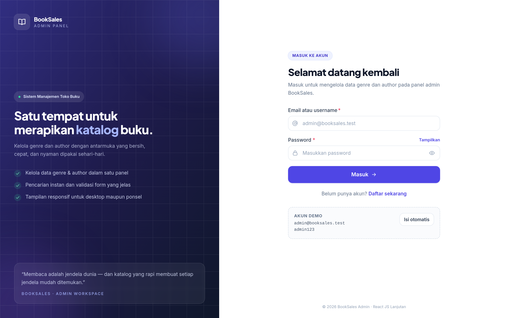
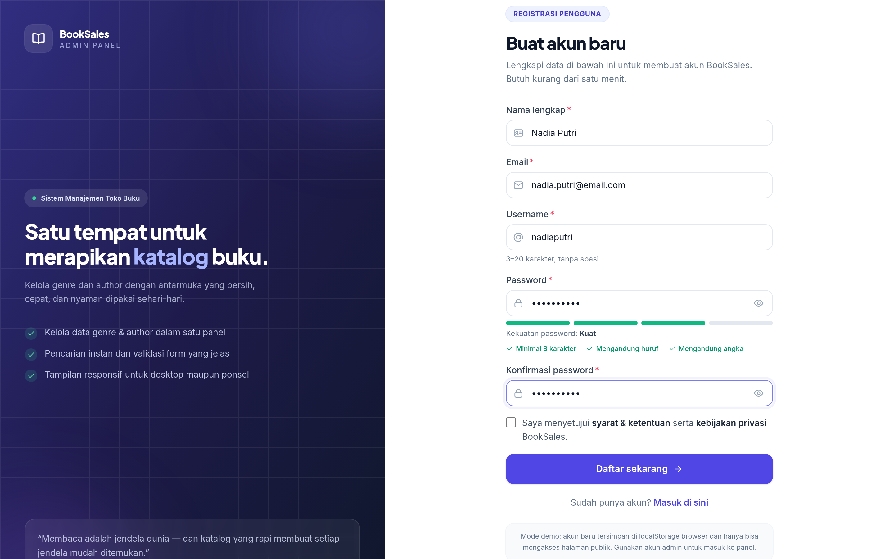
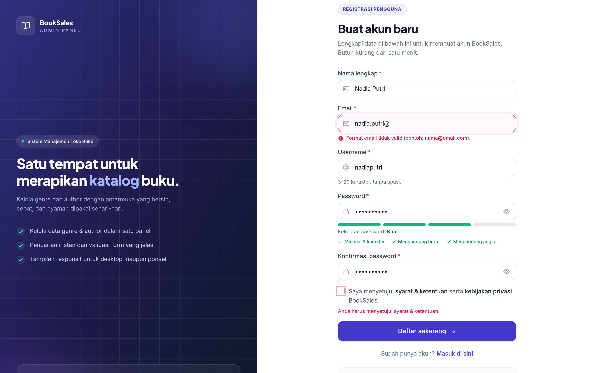
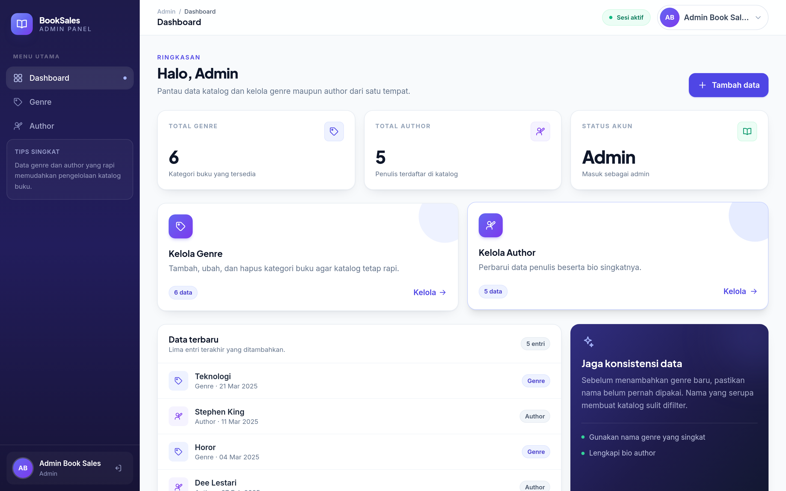
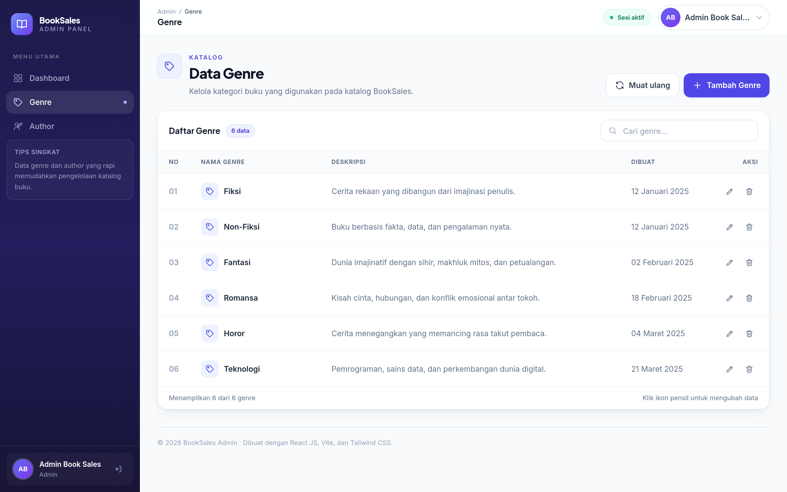
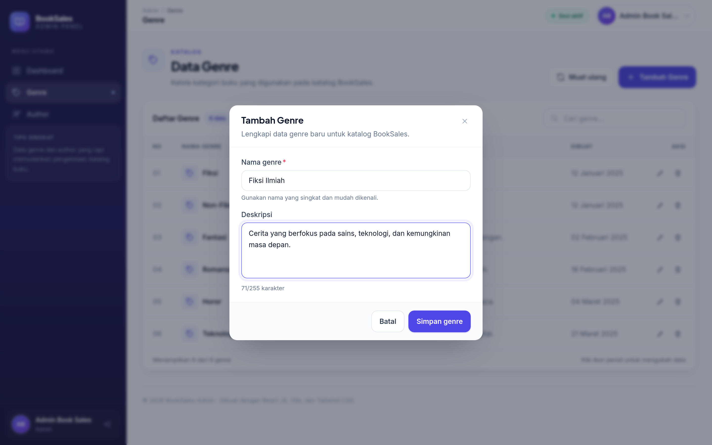
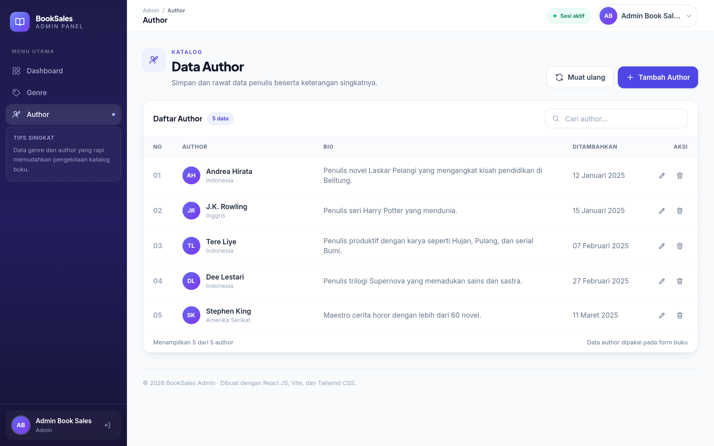
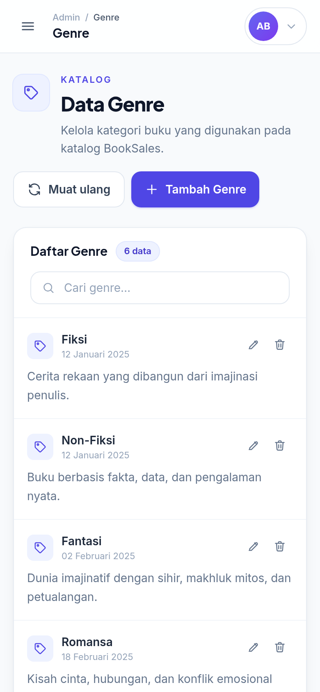

# BookSales Admin — React JS Lanjutan

Aplikasi panel admin toko buku berbasis **React JS** yang memuat fitur **registrasi pengguna**, serta **CRUD (Create, Read, Update, Delete) untuk data Genre dan Author**. Antarmuka dibuat responsif, bersih, dan mudah digunakan.



---

## Daftar Fitur

| No | Fitur | Keterangan |
|----|-------|------------|
| 1 | **Registrasi pengguna** | Form nama lengkap, email, username, password, dan konfirmasi password. Dilengkapi validasi real-time, indikator kekuatan password, serta pesan error yang jelas. |
| 2 | **Login & proteksi halaman** | Login memakai email/username + password, token JWT disimpan di `localStorage`, dan halaman admin hanya bisa diakses oleh role `admin`. |
| 3 | **Read data genre** | Tabel data genre dengan pencarian instan, jumlah data, dan tampilan kartu pada layar kecil. |
| 4 | **Create data genre** | Modal form dengan validasi nama (minimal 3 karakter) dan deskripsi. Nama genre tidak boleh duplikat. |
| 5 | **Update data genre** | Modal edit terisi otomatis dari data yang dipilih, lalu daftar diperbarui tanpa reload halaman. |
| 6 | **Delete data genre** | Dialog konfirmasi sebelum menghapus, dilengkapi notifikasi hasil. |
| 7 | **Read data author** | Tabel author (nama, kebangsaan, bio) dengan pencarian dan tampilan responsif. |
| 8 | **Create / Update / Delete author** | Pola sama seperti genre, memakai modal form dan dialog konfirmasi. |
| 9 | **Notifikasi (toast)** | Umpan balik setiap aksi simpan, ubah, dan hapus. |
| 10 | **Desain responsif** | Sidebar berubah menjadi drawer di ponsel, tabel berubah menjadi daftar kartu. |

---

## Teknologi

- **React 18** + **Vite** (build tool)
- **React Router DOM v6** — routing & route guard
- **Axios** — HTTP client dengan service layer
- **Tailwind CSS 3** — styling dan desain responsif
- **react-jwt** — membaca & memvalidasi masa berlaku token
- **Mock API** bawaan (localStorage) agar aplikasi bisa langsung dijalankan tanpa backend

---

## Cara Menjalankan

```bash
# 1. Clone repository
git clone https://github.com/USERNAME/bookstore-admin.git
cd bookstore-admin

# 2. Install dependency
npm install

# 3. Salin konfigurasi environment
cp .env.example .env      # Windows: copy .env.example .env

# 4. Jalankan development server
npm run dev
```

Buka `http://localhost:5173` pada browser.

Build untuk produksi:

```bash
npm run build
npm run preview
```

### Mengunggah ke GitHub

```bash
git init
git add .
git commit -m "Tugas React JS Lanjutan - registrasi & CRUD"
git remote add origin https://github.com/USERNAME/bookstore-admin.git
git branch -M main
git push -u origin main
```

Setelah itu buka **Settings → Collaborators → Add people** pada repository, lalu undang username GitHub mentor sebagai collaborator. Pastikan status repository tetap **Private**.

### Akun demo (mode `VITE_USE_MOCK=true`)

| Role | Email | Username | Password |
|------|-------|----------|----------|
| Admin | `admin@booksales.test` | `admin` | `admin123` |
| Customer | `customer@booksales.test` | `customer` | `customer123` |

> Akun hasil registrasi baru memiliki role `customer`, sehingga belum bisa membuka panel admin. Ini sesuai aturan otorisasi, bukan bug.

---

## Konfigurasi API

Semua konfigurasi ada pada file `.env`:

```env
# true  -> memakai mock API (data di localStorage, tanpa backend)
# false -> memakai backend sungguhan
VITE_USE_MOCK=true

VITE_API_BASE_URL=http://127.0.0.1:8000/api
```

Bila ingin memakai backend Laravel milik sendiri, set `VITE_USE_MOCK=false` lalu sesuaikan `VITE_API_BASE_URL`. Endpoint yang diharapkan:

| Method | Endpoint | Fungsi |
|--------|----------|--------|
| POST | `/login` | Login, mengembalikan `token` + `user` |
| POST | `/register` | Registrasi pengguna baru |
| POST | `/logout` | Logout (Bearer token) |
| GET | `/genres` | Daftar genre |
| POST | `/genres` | Tambah genre |
| PUT | `/genres/{id}` | Ubah genre |
| DELETE | `/genres/{id}` | Hapus genre |
| GET | `/authors` | Daftar author |
| POST | `/authors` | Tambah author |
| PUT | `/authors/{id}` | Ubah author |
| DELETE | `/authors/{id}` | Hapus author |

---

## Struktur Folder

```
bookstore-admin/
├─ docs/
│  └─ screenshots/          # Dokumentasi tampilan aplikasi
├─ public/
│  └─ favicon.svg
├─ src/
│  ├─ api/
│  │  ├─ client.js          # Instance Axios + pemilihan mock/real API
│  │  └─ mockApi.js         # Mock backend berbasis localStorage
│  ├─ components/
│  │  └─ ui/                # Komponen reusable (Button, Input, Modal, dll.)
│  ├─ context/
│  │  ├─ AuthContext.jsx    # State login, logout, validasi token
│  │  └─ ToastContext.jsx   # Notifikasi global
│  ├─ layouts/
│  │  ├─ AdminLayout.jsx    # Sidebar + topbar area admin
│  │  └─ AuthLayout.jsx     # Kerangka halaman login & registrasi
│  ├─ pages/
│  │  ├─ admin/
│  │  │  ├─ Dashboard.jsx
│  │  │  ├─ GenreList.jsx   # Read, create, update, delete genre
│  │  │  └─ AuthorList.jsx  # Read, create, update, delete author
│  │  ├─ auth/
│  │  │  ├─ Login.jsx
│  │  │  └─ Register.jsx    # Registrasi pengguna + validasi
│  │  └─ NotFound.jsx
│  ├─ routes/
│  │  ├─ ProtectedRoute.jsx # Hanya untuk admin yang sudah login
│  │  └─ GuestRoute.jsx     # Login/register tidak bisa diakses setelah login
│  ├─ services/
│  │  ├─ authService.js
│  │  ├─ genreService.js
│  │  └─ authorService.js
│  ├─ utils/
│  │  ├─ cn.js
│  │  ├─ format.js
│  │  └─ validation.js      # Seluruh aturan validasi form
│  ├─ App.jsx
│  ├─ index.css
│  └─ main.jsx
├─ .env.example
├─ index.html
├─ package.json
├─ postcss.config.js
├─ tailwind.config.js
└─ vite.config.js
```

---

## Alur Kerja Singkat

1. **Halaman registrasi** (`/register`) memvalidasi input di sisi klien, lalu memanggil `authService.register()`.
2. Bila berhasil, pengguna diarahkan ke `/login` dan mendapat notifikasi.
3. **Login** menyimpan `access_token` dan `user_info` di `localStorage`; `AuthContext` memvalidasi token dengan `react-jwt`.
4. **ProtectedRoute** memeriksa token dan role sebelum menampilkan `AdminLayout`.
5. Halaman **Genre** dan **Author** memuat data lewat service, menampilkan tabel, dan menyediakan modal untuk tambah/ubah serta dialog konfirmasi untuk hapus.

---

## Tangkapan Layar

| Registrasi | Validasi form |
|---|---|
|  |  |

| Dashboard admin | Data genre |
|---|---|
|  |  |

| Form tambah genre | Data author |
|---|---|
|  |  |

| Tampilan mobile |
|---|
|  |

---

## Catatan

- Proyek ini dikerjakan secara mandiri untuk tugas **React JS Lanjutan**.
- Mode demo (mock API) disediakan agar penilai dapat mencoba aplikasi tanpa perlu menyiapkan backend.
- Seluruh kode ditulis dengan struktur folder yang terpisah antara `api`, `services`, `components`, `pages`, dan `utils` supaya mudah dibaca dan dikembangkan.
